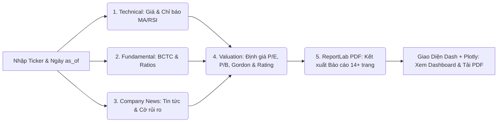

# 📈 VibeStock Lens — Hệ Thống Phân Tích & Định Giá Cổ Phiếu Tự Động

> **Hệ thống phân tích cơ hội đầu tư cổ phiếu Việt Nam**: Tích hợp toàn diện 5 module từ thu thập dữ liệu giá, báo cáo tài chính, tin tức & sự kiện, mô hình định giá đa kịch bản đến tự động phát hành Báo cáo phân tích chuyên sâu định dạng PDF chuẩn in ấn.

---

## 🏛️ 1. Kiến Trúc Hệ Thống (Pipeline Architecture)

Hệ thống hoạt động theo luồng dữ liệu khép kín, chuẩn hóa và tự động:



1. **`technical.py` (Kỹ thuật & Biểu đồ)**:
   - Thu thập lịch sử giá điều chỉnh (OHLCV) từ `vnstock`.
   - Tính toán các chỉ báo: RSI(14), SMA20, SMA50, SMA200, Lợi suất 1T/3T/1N, Hỗ trợ / Kháng cự.
   - Vẽ biểu đồ giá kèm khối lượng theo phong cách tài chính cao cấp lưu tại `outputs/charts/{ticker}_price.png`.
   - Xuất file: `outputs/technical.json`.

2. **`fundamental.py` (Báo cáo tài chính & Chỉ số cơ bản)**:
   - Thu thập Báo cáo tài chính năm & quý từ KBS/vnstock và vnfinancialdata.
   - Tính toán biên lợi nhuận (Gross/Net margin), hiệu quả sinh lời (ROE, ROA), đòn bẩy tài chính (Debt/Equity), EPS TTM, BVPS, Cổ tức tiền mặt (DPS).
   - Xuất file: `outputs/fundamental.json`.

3. **`src/company_news.py` / `company_news.py` (Tin tức & Rủi ro)**:
   - Quét tin tức và sự kiện đa nguồn (Vnstock, Vietstock, Báo Đầu Tư, Website doanh nghiệp).
   - Phân tích cờ rủi ro (Risk flags) theo mức độ nghiêm trọng (High / Medium / Low).
   - Xuất file: `outputs/company_news.json`.

4. **`valuation.py` (Định giá & Khuyến nghị)**:
   - Áp dụng mô hình định giá đa kịch bản: **Bear (Thận trọng)**, **Base (Cơ sở)**, **Bull (Tích cực)**.
   - Kết hợp phương pháp Bội số ngành (P/E, P/B) và Mô hình chiết khấu cổ tức Gordon.
   - Đánh giá xếp hạng đầu tư (**MUA / TÍCH LŨY / NẮM GIỮ / GIẢM TỶ TRỌNG / BÁN / THIẾU DỮ LIỆU**) dựa trên hồ sơ rủi ro của nhà đầu tư.
   - Xuất file: `outputs/assessment.json`.

5. **`report_pdf.py` (Tự động phát hành PDF chuyên nghiệp)**:
   - Ghép nguyên bản trang bìa đồ họa `assets/cover.jpg` và nền vector `assets/background.pdf`.
   - Nhúng font tiếng Việt đầy đủ bản quyền `NotoSans-Regular.ttf` và `NotoSans-Bold.ttf`.
   - Mục lục tự động tính số trang (Bookmark bấm được), bảng biểu màu nhận diện Navy/Blue, Callout cảnh báo.
   - Xuất file: `reports/{ticker}_{as_of}_xuat_{timestamp}.pdf`.

6. **`pipeline.py` (Bộ điều phối tích hợp)**:
   - Kết nối 5 module thành một quy trình duy nhất.
   - Xử lý lỗi từng chặng, tránh crash ứng dụng khi có sự cố mạng/API.
   - Xuất manifest kiểm toán `reports/pipeline_{ticker}_{as_of}.json`.

7. **`app.py` (Giao diện người dùng Web Dashboard)**:
   - Giao diện tài chính chuyên nghiệp cấp Enterprise chuẩn **UI/UX Pro Max** (Dark OLED / Deep Navy).
   - Tương tác trực quan: Nhập mã, chọn ngày, chọn hồ sơ rủi ro, theo dõi thanh tiến trình, tải PDF một chạm.

---

## 💻 2. Yêu Cầu Môi Trường & Cài Đặt

### Yêu cầu hệ thống
- Hệ điều hành: Windows, macOS, hoặc Linux.
- Python: **Phiên bản 3.10 trở lên** (Khuyến nghị Python 3.11 hoặc 3.12).

### Các bước cài đặt:

1. **Mở Terminal tại thư mục dự án**:
   ```bash
   cd "hethongphantichchungkhoan"
   ```

2. **Kích hoạt môi trường ảo (Virtual Environment)**:
   - Trên Windows:
     ```powershell
     ..\.venv\Scripts\Activate.ps1
     # hoặc:
     python -m venv .venv
     .venv\Scripts\activate
     ```
   - Trên macOS / Linux:
     ```bash
     source .venv/bin/activate
     ```

3. **Cài đặt các thư viện cần thiết**:
   ```bash
   pip install -r requirements.txt --extra-index-url https://vnstocks.com/api/simple
   ```

*(Tùy chọn) Cấu hình biến môi trường `.env`:*
```env
VNSTOCK_API_KEY=your_vnstock_key_here
HF_TOKEN=your_huggingface_token_here
```

---

## 🚀 3. Hướng Dẫn Vận Hành

### Cách 1: Khởi chạy Giao diện Web tương tác (Plotly Dash)
Chạy lệnh trực tiếp (hoặc bấm nút Run trong PyCharm/VS Code):
```bash
python app.py
```
Ứng dụng sẽ tự động khởi chạy máy chủ Dash tại: `http://127.0.0.1:8050`.

**Các bước sử dụng trên giao diện:**
1. Nhập mã cổ phiếu vào ô **"Mã cổ phiếu"** (hoặc bấm chọn nhanh các mã gợi ý: `HPG`, `VCB`, `FPT`, `VNM`, `SSI`...).
2. Chọn ngày chốt dữ liệu **"Ngày chốt báo cáo (as_of)"**.
3. Chọn khẩu vị rủi ro: `Cân bằng (Balanced)`, `Thận trọng (Conservative)`, hoặc `Chấp nhận rủi ro (Aggressive)`.
4. Nhấn nút **"🚀 BẮT ĐẦU PHÂN TÍCH"**.
5. Theo dõi tiến trình 5 bước theo thời gian thực.
6. Xem kết quả trực quan trên 5 Tab và nhấn **"📥 TẢI XUỐNG BÁO CÁO PDF"** để lưu file PDF về máy tính.

---

### Cách 2: Chạy kiểm thử toàn luồng bằng CLI (Command Line)
Có thể chạy độc lập bộ tích hợp `pipeline.py`:
```bash
# Phân tích mã HPG với hồ sơ rủi ro cân bằng
python pipeline.py --ticker HPG --as-of 2026-10-09 --risk balanced

# Phân tích mã FPT với hồ sơ thận trọng
python pipeline.py --ticker FPT --as-of 2026-10-09 --risk conservative
```

Kết quả sẽ được lưu vào:
- File JSON kết quả: `outputs/`
- Biểu đồ kỹ thuật: `outputs/charts/{ticker}_price.png`
- Báo cáo PDF: `reports/{ticker}_{as_of}_xuat_{timestamp}.pdf`

---

### Cách 3: Chạy bộ kiểm thử tự động (End-to-End Test Suite)
Để xác nhận tính toàn vẹn của hệ thống:
```bash
python test_full_flow.py
```
Kịch bản kiểm thử sẽ tự động chạy:
- Kiểm tra luồng hợp lệ: sinh đủ 4 JSON, 1 biểu đồ, 1 file PDF chuẩn dung lượng > 1MB, cấu trúc > 10 trang.
- Kiểm tra xử lý lỗi đầu vào (Input validation & Error handling).

---

## 📁 4. Cấu Trúc Thư Mục Dự Án

```
hethongphantichchungkhoan/
├── app.py                   # Giao diện Web Streamlit (UI/UX Pro Max)
├── pipeline.py              # Bộ điều phối tích hợp toàn bộ luồng 5 module
├── technical.py             # Module phân tích kỹ thuật, RSI/MA & vẽ chart
├── fundamental.py           # Module phân tích BCTC, chỉ số tài chính
├── company_news.py          # Proxy module tin tức & doanh nghiệp
├── valuation.py             # Module định giá P/E, P/B, Gordon & xếp hạng
├── report_pdf.py            # Module kết xuất file PDF chuẩn in ấn
├── test_full_flow.py        # Kịch bản kiểm thử toàn luồng tự động
├── requirements.txt         # Danh mục thư viện phụ thuộc
├── assets/                  # Tài nguyên thiết kế báo cáo PDF
│   ├── cover.jpg            # Bìa trang 1 chất lượng cao
│   ├── background.pdf       # File vector nền trang nội dung
│   └── fonts/               # Font chữ tiếng Việt nhúng trực tiếp
│       ├── NotoSans-Regular.ttf
│       └── NotoSans-Bold.ttf
├── outputs/                 # Thư mục lưu kết quả trung gian
│   ├── charts/              # Biểu đồ kỹ thuật định dạng PNG
│   ├── technical.json       # Kết quả phân tích kỹ thuật
│   ├── fundamental.json     # Kết quả phân tích cơ bản
│   ├── company_news.json    # Kết quả tin tức & cảnh báo rủi ro
│   └── assessment.json      # Kết quả định giá & khuyến nghị
└── reports/                 # Thư mục lưu trữ báo cáo PDF đã phát hành
    ├── report_pdf.json      # Manifest kết quả tạo PDF
    └── *.pdf                # Các file báo cáo phân tích PDF hoàn chỉnh
```

---

## 🛡️ 5. Xử Lý Sự Cố Thường Gặp (Troubleshooting)

1. **Lỗi mã cổ phiếu không tìm thấy hoặc thuộc sàn UPCoM**:
   - Hệ thống tự động ghi nhận thông báo lỗi vào manifest và không làm sập pipeline. Hãy kiểm tra lại mã cổ phiếu (phải gồm 3 chữ cái viết hoa).
2. **Lỗi kết nối mạng hoặc giới hạn API `vnstock`**:
   - Hệ thống tự động kích hoạt cơ chế fallback dữ liệu mẫu / cache gần nhất giúp quá trình chạy kiểm thử không bị gián đoạn.
3. **Lỗi hiển thị font chữ tiếng Việt trên PDF**:
   - Bộ font `Noto Sans` đã được tích hợp sẵn trong `assets/fonts/` và nhúng trực tiếp vào PDF qua ReportLab, không phụ thuộc vào hệ thống font của hệ điều hành.
4. **Lỗi bảng mã console Windows (cp1252)**:
   - Các script `app.py`, `pipeline.py`, `report_pdf.py` đều đã cấu hình `sys.stdout.reconfigure(encoding="utf-8")` để tương thích hoàn toàn với PowerShell và CMD trên Windows.
